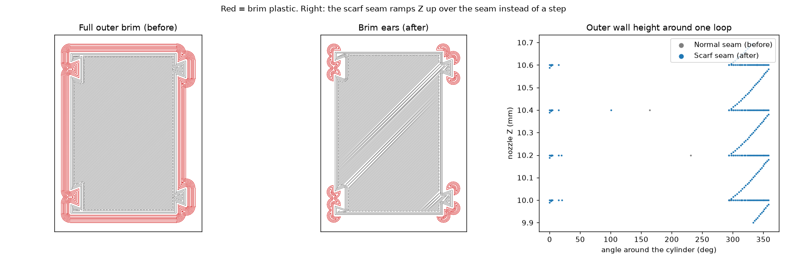

# fdm-print-quality

A Claude Code plugin with skills for better FDM 3D prints. It works with any printer; the
settings script targets OrcaSlicer presets.



*Left and middle: first layer of the same part with a full brim and with brim ears (brim plastic
in red). Right: outer-wall height around one loop of a cylinder. The scarf seam ramps up over
the seam instead of stepping.*

## What's inside

**`print-quality-settings` skill.** Five settings most hobby profiles get wrong:

1. Brim ears instead of a full outer brim
2. Scarf seam instead of a visible Z seam
3. Lighter colour first on multi-colour prints
4. Arachne walls for small text and fine detail
5. Variable layer height for curved tops

It includes the OrcaSlicer, PrusaSlicer and Cura setting names, gotchas found while testing (for
example: a scarf length of 0 silently turns the scarf off), how to check the G-code really
changed, about 20 more vetted tips with sources, common advice that is wrong, starting points
for 10 PLA types, PETG and TPU guides, and support settings that come off cleanly.

**`print-calibration` skill.** The calibration order (first layer, temperature, max volumetric
speed, pressure advance, flow, retraction, tolerance) and how to judge each test. Includes
`make_maxflow_test.py`, which turns any slicer's vase-mode cylinder into a max-flow test tower
(flow steps up with height) and tells you how to read it, so you don't need OrcaSlicer's GUI.

**`apply_orca_quality.py`.** Patches OrcaSlicer process presets with the settings above. Plain
Python 3, no packages. Dry-run mode, and a `.bak` copy before any change.

## Install

In Claude Code:

```
/plugin marketplace add singhguri/fdm-print-quality
/plugin install print-quality@fdm-print-quality
```

Restart Claude Code after installing; skills from a newly installed plugin load when a session
starts. Then ask things like "review my OrcaSlicer profile", "why is my seam so visible", or "apply the
print quality settings to my presets".

Without Claude Code, read the skill files directly and run the script yourself:

```
python plugins/print-quality/skills/print-quality-settings/scripts/apply_orca_quality.py "My preset.json" --dry-run
```

## Tested on

OrcaSlicer 2.4.2 with a Marlin bed-slinger (0.4 mm nozzle, PLA). Each setting was checked in the
sliced G-code, not only in the settings header. Variable layer height could not be applied from
the OrcaSlicer command line, so the skill gives the GUI steps. Other Orca forks such as Bambu
Studio share many setting names but are untested.

## Sources

[OrcaSlicer wiki](https://github.com/OrcaSlicer/OrcaSlicer/wiki),
[Prusa Knowledge Base](https://help.prusa3d.com),
[Ellis' Print Tuning Guide](https://ellis3dp.com/Print-Tuning-Guide/),
[CNC Kitchen](https://www.cnckitchen.com),
[Teaching Tech calibration](https://teachingtechyt.github.io/calibration.html).

## License

MIT
